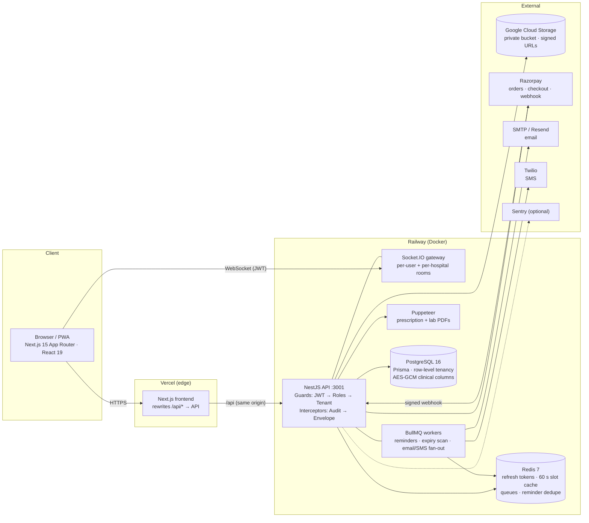
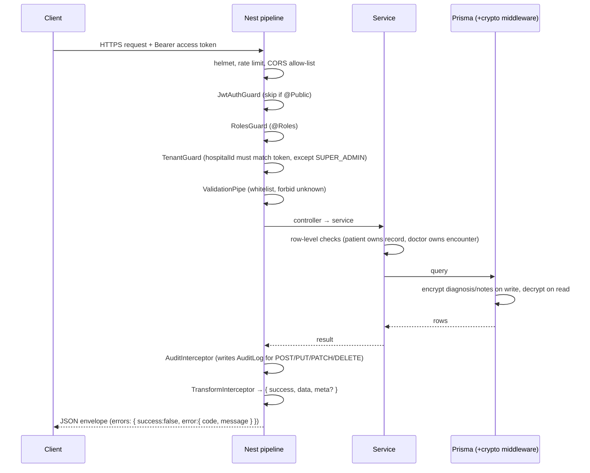

# MedCore HMS — Architecture

## 1. Component diagram

The Docker Compose setup (`docker-compose.yml`) runs the same pieces locally: postgres, redis, api,
frontend and an nginx reverse proxy (`nginx/nginx.conf`) that serves the frontend, forwards
`/api/*` to NestJS and keeps WebSocket upgrade headers.

## 2. Request lifecycle

## 3. Key design decisions

### Multi-tenancy: row-level

| Approach | Isolation | Cost | Migrations | Cross-tenant analytics |
| --- | --- | --- | --- | --- |
| Database per tenant | Highest | One DB per hospital | N runs | Hard |
| Schema per tenant | High | Shared server | N runs | UNIONs |
| **Row-level (`hospitalId`)** | High with guards + tests | One pool | One run | Native |

Every hospital-owned table carries an indexed `hospitalId`. `TenantGuard` copies the caller's
hospital from the JWT onto the request and rejects any explicit `hospitalId` that differs.
Services additionally check ownership on records fetched by id, which is what stops
"guess a UUID" attacks. Super Admins are the only cross-tenant role. `test/tenancy.e2e-spec.ts`
and `test/patients.e2e-spec.ts` prove isolation on every CI run.

### Appointment concurrency: database-enforced

Two partial unique indexes on `appointments` cover active statuses (not CANCELLED, NO_SHOW or COMPLETED):

- `(doctorId, scheduledDate, scheduledTime)` — a doctor slot can be held once.
- `(patientId, scheduledDate, scheduledTime)` — a patient cannot be in two places at once.

The service does a friendly pre-check, but the index is the source of truth. When two requests
race, Postgres lets one insert win and the other gets `P2002`, which maps to
`409 SLOT_UNAVAILABLE`. This avoids holding row locks (`SELECT … FOR UPDATE`) across the
invoice and notification work in the same request, and it works across multiple API replicas.
Emergency bookings skip the doctor-slot pre-check and are flagged `EMERGENCY`.

### Caching (Redis)

| Use | Key | TTL |
| --- | --- | --- |
| Refresh tokens per device (rotation, logout-all) | `rt:{userId}:{deviceId}` | 7 days |
| Doctor availability slots | `avail:{doctorId}:{date}` | 60 s, cleared on booking/status change |
| Reminder de-duplication | per appointment + window | until window passes |
| BullMQ queues | `bull:*` | n/a |

Availability is read far more than written, but it changes on every booking, so the TTL is
short and writes clear the key immediately.

### Doctor availability model

Each `Doctor` stores a repeating `weeklySchedule` (JSON: per weekday, one or more
`{start, end, slotDuration}` windows). Free slots for a date are computed from that schedule
minus active appointments. A weekly template is simpler to edit and keeps the table small;
one-off leave is handled by `isAvailable` or by cancelling the affected slots.

### Prescriptions ↔ medicines

`Prescription` → many `PrescriptionItem` → one `Medicine`. Dosage, frequency (OD/BD/TDS/QID/SOS),
duration and instructions live on the item, because they differ per medicine in the same
prescription.

### Lab results: hybrid

Each `LabOrder` has `LabTest` rows copied from the hospital's `LabTestCatalog`, including
gender-specific reference ranges at order time. Results are structured `LabResult` rows
(value, unit, `isAbnormal`), so out-of-range values are flagged automatically and shown in
red. The PDF report is rendered from that data.

### Pharmacy: FIFO with quarantine

Stock lives in `MedicineBatch` (batch number, mfg/expiry dates, quantity, cost, MRP).
Dispensing runs in one transaction that consumes the batches with the earliest expiry
first and never touches expired or quarantined batches. A nightly BullMQ job reports
batches expiring within 30 days to pharmacists and hospital admins.

## 4. Security controls

| Control (PRD §10) | Implementation |
| --- | --- |
| Password hashing | bcrypt cost 12 |
| Transport | HTTPS terminated by Vercel and Railway in production; the compose nginx listens on :80 for local use (add a certificate + 301 redirect when hosting on a VM) |
| JWT secrets | 256-bit random, env only; access 15 min, refresh 7 days |
| Refresh rotation | new refresh token on every use; replaying an old one is rejected (tested) |
| Rate limiting | 100 req / 15 min per IP on `/api/auth/*`; 1000 / 15 min elsewhere |
| CORS | strict allow-list from `CORS_ORIGIN` / `FRONTEND_URL` |
| Headers | `helmet()` defaults |
| SQL injection | Prisma parameterised queries; the only raw SQL is static migrations |
| XSS | React escapes output; no `dangerouslySetInnerHTML` on user input |
| CSRF | refresh cookie is `httpOnly`, `SameSite=Strict`, `Secure` in production; state-changing calls need a Bearer header, which browsers never send cross-site |
| Input validation | global `ValidationPipe` (whitelist + forbid unknown); Zod on the login/register forms |
| Audit logging | `AuditInterceptor` records user, hospital, action, entity, IP and user agent for every write |
| File uploads | extension + MIME allow-list, magic-byte check, 20 MB cap, private bucket, signed URLs |
| Encryption at rest | AES-256-GCM on `diagnosis`, `differentialDiagnosis`, `treatmentPlan`, `notes` |
| Secrets in logs | `redact()` strips password/token/OTP/signature fields from logs, audit rows and Sentry events |
| Soft deletes | `deletedAt` on Patient, Doctor, Appointment; medical records are never hard-deleted |

## 5. Deployment

| Layer | Where | Notes |
| --- | --- | --- |
| Frontend | Vercel — https://medcore-hms-web.vercel.app | `/api/*` rewritten to the API, same origin |
| API + workers + Socket.IO | Railway (`apps/backend/Dockerfile`) | `prisma migrate deploy` on boot; Swagger at `/api/docs` |
| PostgreSQL 16, Redis 7 | Railway managed | private network only |
| Files | Google Cloud Storage `medcore-hms-files-*` | uniform access, public access prevention |
| CI | GitHub Actions `.github/workflows/ci.yml` | typecheck, e2e + coverage, frontend build |

The brief suggests AWS EC2/RDS/S3. Railway and GCS run the same container and managed
Postgres/Redis with TLS and zero server maintenance, which suits a solo four-week build.
Moving to EC2 needs only the compose file and the same env vars.
